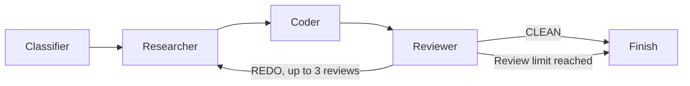

# ⚡ LUMINA — AI DevOps Troubleshooter

<p align="center">
  
  
  
  
  
</p>

> **Diagnose. Research. Propose. Review.**

LUMINA turns a pasted DevOps or software error into a cited fix proposal. It classifies the error, searches the web, drafts a fix, and has a second AI step review that draft. If the review requests changes, the feedback goes back into the next attempt.

LUMINA only proposes fixes. It does not run them or change your systems.

---

## 🌟 Features

- 🔍 **Error classification**: Sorts errors into Syntax, Logic, Environment, Dependency or Permission using a validated schema.
- 🌐 **Web research**: Uses Tavily to find current sources and lists them with the fix.
- 🔁 **Review loop**: A reviewer step returns `CLEAN` or `REDO`. On `REDO`, the next attempt receives the previous fix and the feedback.
- 🧾 **Honest results**: The UI shows whether the fix passed AI review and how many sources were used, and warns you when either is missing.

---

## 🧠 How It Works

LUMINA is a LangGraph state machine with one feedback loop:



1. **Classifier**: Picks one error category.
2. **Researcher**: Searches the web, using reviewer feedback on later attempts.
3. **Coder**: Writes the root cause, solution, verification steps and prevention tips.
4. **Reviewer**: Checks safety, correctness, completeness and best practices.
5. **Router**: Stops on `CLEAN` or after 3 reviews. Otherwise it loops back to research.

---

## 🚀 Getting Started

```bash
python -m venv venv
source venv/bin/activate    # Windows: venv\Scripts\activate
pip install -r requirements.txt
```

Create a `.env` file. It is ignored by git, so never commit or upload it:

```bash
GOOGLE_API_KEY=your_key_here
TAVILY_API_KEY=your_key_here
```

Start the app:

```bash
streamlit run ui.py
```

To run the built-in test from the command line:

```bash
python app.py
```

---

## ⚠️ Current Limitations

- "Passed review" means an AI approved the written fix. The fix has not been run or tested.
- There is no accuracy benchmark yet.
- Pasted logs are sent to Gemini and Tavily. Remove passwords, keys and private data first.
- Logs are not yet protected against prompt injection.
- LUMINA cannot see your code, config or live systems.

---

## 🛠️ Tech Stack

- **Orchestration**: [LangGraph](https://github.com/langchain-ai/langgraph)
- **LLM**: Google Gemini 3.6 Flash
- **Search**: Tavily AI
- **Validation**: Pydantic
- **Interface**: Streamlit

---

## 🧑‍💻 Developer

Swarangi Kothawade, Computer Science & Engineering (AI & Data Science)
