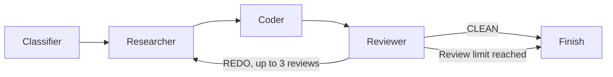

# ⚡ LUMINA — AI DevOps Troubleshooter

<p align="center">
  
  
  
  
  
</p>

> **Diagnose. Research. Propose. Review.**

LUMINA turns a pasted DevOps or software error into a cited fix proposal. It classifies the error, searches the web, drafts a fix, and has a second AI step review that draft. If the review requests changes, the feedback goes back into the next attempt.

LUMINA only proposes fixes. It does not run them or change your systems.

---

## 🌟 Features

- 🔍 **Error classification**: Sorts errors into Syntax, Logic, Environment, Dependency or Permission using a validated schema.
- 🌐 **Web research**: Uses Tavily to find current sources and lists them with the fix.
- 🔁 **Review loop**: A reviewer step returns `CLEAN` or `REDO`. On `REDO`, the next attempt receives the previous fix and the feedback.
- 🧾 **Honest results**: The UI shows whether the fix passed AI review and how many sources were used, and warns you when either is missing.

---

## 🧠 How It Works

LUMINA is a LangGraph state machine with one feedback loop:



1. **Classifier**: Picks one error category.
2. **Researcher**: Searches the web, using reviewer feedback on later attempts.
3. **Coder**: Writes the root cause, solution, verification steps and prevention tips.
4. **Reviewer**: Checks safety, correctness, completeness and best practices.
5. **Router**: Stops on `CLEAN` or after 3 reviews. Otherwise it loops back to research.

---

## 🚀 Getting Started

```bash
python -m venv venv
source venv/bin/activate    # Windows: venv\Scripts\activate
pip install -r requirements.txt
```

Copy `.env.example` to `.env` and add your keys. `.env` is ignored by git, so never commit or upload it.

Start the app:

```bash
streamlit run ui.py
```

Or use the command line, with your own error or the built-in sample:

```bash
python cli.py "ModuleNotFoundError: No module named 'requests'"
```

Or run it in Docker:

```bash
docker build -t lumina .
docker run --env-file .env -p 8501:8501 lumina
```

---

## 🧪 Development

```bash
pip install -r requirements-dev.txt
ruff check .
pytest
```

The tests use fake LLM and search services, so they need no API keys and make no paid calls. GitHub Actions runs linting, tests and a Docker build on every pull request.

```text
agent/     Workflow, nodes, schemas and Gemini access
tools/     Web search
evals/     Benchmark cases, scoring and reports
cli.py     Command line entry point
ui.py      Streamlit interface
tests/     Automated tests
```

---

## 📊 Benchmark

`evals/cases.jsonl` holds 50 hand-labelled errors, 10 per category, including trap cases that invite a dangerous fix. Each result is scored by fixed rules for category, root-cause keywords, unsafe commands in code, and valid citations.

```bash
python -m evals.run --limit 3
python -m evals.report
```

Runs are resumable. Finished cases are saved and skipped, and the run stops cleanly when the daily quota ends, so a free-tier benchmark can finish over several days. Compare results only when they share a model and commit.

---

## ⚠️ Current Limitations

- "Passed review" means an AI approved the written fix. The fix has not been run or tested.
- The benchmark uses hand-written cases and keyword rules, so its scores are a rough guide, not proof of correctness.
- Each run makes 4 to 7 Gemini requests. A free-tier key with a limit of 20 requests a day allows only a few runs.
- Pasted logs are sent to Gemini and Tavily. Remove passwords, keys and private data first.
- Logs are not yet protected against prompt injection.
- LUMINA cannot see your code, config or live systems.

---

## 🛠️ Tech Stack

- **Orchestration**: [LangGraph](https://github.com/langchain-ai/langgraph)
- **LLM**: Google Gemini 3.6 Flash
- **Search**: Tavily AI
- **Validation**: Pydantic
- **Interface**: Streamlit

---

## 🧑‍💻 Developer

Swarangi Kothawade, Computer Science & Engineering (AI & Data Science)
